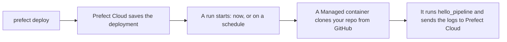

# Lab 4 · Deploy hello world to Prefect Cloud

**Time:** 45 minutes · **You will:** run your hello-world pipeline in the cloud, from code on GitHub, without your laptop.

[All labs](README.md) · Previous: [Lab 3](lab-03-hello-pipeline.md) · Next: [Lab 5 · Extract into Bronze](lab-05-extract-bronze.md)

## Why it matters

Deploying *before* the real pipeline exists sounds backwards, but it is how professionals work. Deploying a trivial pipeline proves your accounts, permissions and configuration work while there is almost nothing to debug. Later, when the real pipeline fails in the cloud, you'll know the cause is your new code, not the setup.

| Word | Meaning |
| --- | --- |
| **Deployment** | A flow plus three facts: where its code lives, where it runs, and when |
| **Work pool** | Where runs execute. A **Prefect Managed** pool runs each one in a fresh cloud container, so you don't need a server |
| **`prefect.yaml`** | The file that describes your deployments. It lives in Git, so every change to it is reviewed and recorded |



## Steps

### 1. Create a Prefect Cloud workspace

Sign up at [app.prefect.cloud](https://app.prefect.cloud) (the free tier is enough) and create a workspace when asked.

### 2. Connect your terminal to Prefect Cloud

Make a second profile for the cloud, so you can switch between local and cloud with one command:

```sh
uv run prefect profile create cloud
uv run prefect profile use cloud
uv run prefect cloud login
```

Choose **Log in with a web browser**, approve the login, and pick your workspace. Check where you're connected:

```sh
uv run prefect config view
```

`PREFECT_API_URL` must start with `https://api.prefect.cloud/api/accounts/`. From now on:

- `uv run prefect profile use local` points the terminal at your laptop's server (Lab 3)
- `uv run prefect profile use cloud` points it at Prefect Cloud

### 3. Create a Managed work pool

```sh
uv run prefect work-pool create --type prefect:managed my-managed-pool
```

**UI route:** in Prefect Cloud, open **Work Pools**, click **+**, choose **Prefect Managed**, name it `my-managed-pool` and click **Create**.

### 4. Describe the deployment in `prefect.yaml`

Create `prefect.yaml` in the project root, next to `pyproject.toml`. Replace `YOUR-USERNAME` with your GitHub username and `my-pipeline` with your repository name:

```yaml
# How Prefect Cloud gets and runs this project's code.
name: my-pipeline

# Before every run, Prefect clones the repository and moves into src/,
# so that `import my_pipeline` works.
pull:
  - prefect.deployments.steps.git_clone:
      id: clone
      repository: https://github.com/YOUR-USERNAME/my-pipeline.git
      branch: main
  - prefect.deployments.steps.set_working_directory:
      directory: "{{ clone.directory }}/src"

deployments:
  - name: hello
    entrypoint: my_pipeline/hello.py:hello_pipeline
    parameters:
      name: Prefect Cloud
    work_pool:
      name: my-managed-pool
```

- `pull` runs **in the cloud** before each run. It clones your repository and changes into `src/`.
- `entrypoint` is `file:function`, written relative to `src/`, because that's where the pull steps leave the run.
- `parameters` are the values the flow receives.

### 5. Push, then deploy

Prefect Cloud runs the code **on GitHub**, not the code on your laptop. Push first:

```sh
git add prefect.yaml
git commit -m "chore: describe the hello deployment"
git push
```

Then register the deployment. Run it from `src/`, so Prefect finds the entrypoint the same way the cloud will:

```sh
cd src
uv run prefect deploy --prefect-file ../prefect.yaml --name hello --no-prompt
cd ..
```

You should see `Deployment 'hello-pipeline/hello' successfully created`. Prefect names deployments `flow-name/deployment-name`, and it builds the flow name from the function name, so `hello_pipeline` becomes `hello-pipeline`.

### 6. Run it in the cloud

```sh
uv run prefect deployment run 'hello-pipeline/hello' --watch
```

**UI route:** open **Deployments → hello**, click **Run → Quick run**.

The first run takes a minute or two, while Prefect starts a container and installs Prefect. Open the run in the UI and read the logs. You should see `Hello, Prefect Cloud!`, the retry, and `Completed`. Your laptop did none of the work.

### 7. Prove the cloud runs what's on GitHub

1. Change the `print` in `hello_pipeline` to say something new. **Don't commit.**
2. Run the deployment again. The logs still show the *old* message.
3. Commit and push, then run it again. Now you see the new message.

This is the most important idea in this lab. **What runs in production is what's on the branch, not what's on your laptop.** Lab 9 uses this to make every production change go through a reviewed pull request.

### 8. Add a schedule, then pause it

Add a `schedules` section to the deployment in `prefect.yaml`, at the same indent as `work_pool`:

```yaml
    schedules:
      - cron: "0 9 * * 1-5"
        timezone: Africa/Accra
```

`0 9 * * 1-5` means 09:00, Monday to Friday. The five fields are *minute, hour, day of month, month, day of week*. Try your own at [crontab.guru](https://crontab.guru/).

Commit, push and deploy again (step 5). Open the deployment in the UI. It now shows the next scheduled runs. Free accounts have limited cloud run time, so **turn the schedule off** with the toggle on the deployment page when you've seen it work.

### 9. Switch back to local

```sh
uv run prefect profile use local
```

Do this whenever you go back to local work, or your local runs will land in Prefect Cloud.

### Your turn

> [!TIP]
> **Using AI?** Copy-and-fill prompts for this lab are in [AI prompts](ai-prompts.md#lab-4--deploy-hello-world). You still need to be able to explain every line you commit.

Deploy your `plan_sketch.py` flow from Lab 3 as a second deployment in the same `prefect.yaml`. Add another item under `deployments:` with its own `name` and `entrypoint`. Deploy with `--name` set to the new name, run it in the cloud, and find its graph in the UI.

## Checkpoint

- [ ] `uv run prefect deployment ls`, with the cloud profile active, lists `hello-pipeline/hello`
- [ ] A cloud run of it is `Completed`, and its logs show the retry
- [ ] You've seen that an unpushed change does not reach the cloud
- [ ] The schedule is paused

## How the workshop repo does it

- Its [`prefect.yaml`](../../prefect.yaml) uses the same pull steps. Instead of `branch: main`, it pins the exact commit that CI tested. Lab 9 does the same.
- It registers deployments from GitHub Actions instead of a laptop. See the `deploy` job in [`ci.yml`](../../.github/workflows/ci.yml) and [Deployment §3–4](../DEPLOYMENT.md#3-set-up-prefect-cloud).

## Stuck?

| Symptom | Fix |
| --- | --- |
| `prefect deploy` says it can't find `my_pipeline/hello.py` | Run it from `src/`, with `--prefect-file ../prefect.yaml` |
| The cloud run fails in `git_clone` with `Authentication failed` or `not found` | The `repository` URL is wrong, or the repository is private. Check the URL in a browser while signed out. For a private repository, create a GitHub fine-grained token with read access to it, save it in Prefect as a **Secret** block called `github-token`, and add `access_token: "{{ prefect.blocks.secret.github-token }}"` under `git_clone` |
| The cloud run fails with `ModuleNotFoundError: No module named 'my_pipeline'` | The `set_working_directory` step is missing, or the `entrypoint` starts with `src/`. It must be relative to `src/` |
| The run stays `Scheduled` or `Pending` | The deployment points at a work pool that doesn't exist or is paused. Check **Work Pools** in the UI |
| Local runs show up in Prefect Cloud | The cloud profile is still active. Run `uv run prefect profile use local` |
| `prefect cloud login` can't open a browser | Create an API key in Prefect Cloud (your profile → **API keys**) and choose **Paste an API key** |

More fixes: [lab troubleshooting](troubleshooting.md#lab-4--prefect-cloud).

## Go further

- [Prefect: deploy with prefect.yaml](https://www.prefect.io/docs/v3/how-to-guides/deployments/prefect-yaml)
- [Prefect: Managed work pools](https://www.prefect.io/docs/v3/how-to-guides/deployment_infra/managed)
